# Práctica 1: Instalación nativa de Nginx

> **Módulo:** Despliegue de Aplicaciones Web  
> **Repositorio:** `despr3_instalacion_nativa`  
> **Objetivo:** Instalar Nginx de forma nativa sobre Ubuntu Server en una máquina virtual, configurar el cortafuegos, desplegar un sitio web estático, diagnosticar errores mediante registros (*logs*) y comparar el proceso frente al uso de contenedores.

---

## Índice
1. [Preparar la máquina virtual](#1-preparar-la-máquina-virtual)
2. [Instalar Nginx](#2-instalar-nginx)
3. [Dónde está cada cosa (Directorios clave)](#3-dónde-está-cada-cosa-directorios-clave)
4. [El cortafuegos (UFW)](#4-el-cortafuegos-ufw)
5. [Subir el sitio al servidor](#5-subir-el-sitio-al-servidor)
6. [Crear y activar el sitio](#6-crear-y-activar-el-sitio)
7. [Provocar errores y diagnosticarlos](#7-provocar-errores-y-diagnosticarlos)
8. [Reinicio de la máquina](#8-reinicio-de-la-máquina)
9. [Comparar con los contenedores](#9-comparar-con-los-contenedores)
10. [Incidencias encontradas y resolución](#10-incidencias-encontradas-y-resolución)

---

## 1. Preparar la máquina virtual

Se ha creado un **clon enlazado** de la máquina virtual base con adaptador de red **NAT** y se han configurado las siguientes reglas de reenvío de puertos en VirtualBox:

| Nombre | Protocolo | IP Anfitrión | Puerto Anfitrión | Puerto Invitado | Uso |
| :--- | :---: | :---: | :---: | :---: | :--- |
| **SSH** | TCP | `127.0.0.1` | `2222` | `22` | Administración remota por consola |
| **HTTP** | TCP | `127.0.0.1` | `8080` | `80` | Acceso al servidor web Nginx |

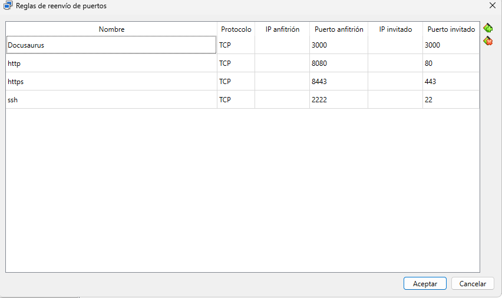

### Acceso por SSH desde el anfitrión
Orden ejecutada desde la terminal del anfitrión y salida obtenida al iniciar sesión:

```bash
$ ssh dawserver@127.0.0.1 -p 2222
dawserver@127.0.0.1's password:
Welcome to Ubuntu 22.04.5 LTS (GNU/Linux 5.15.0-191-generic x86_64)

 * Documentation:  https://help.ubuntu.com
 * Management:     https://landscape.canonical.com
 * Support:        https://ubuntu.com/pro
dawserver@ubuntu-server:~$
```

---

## 2. Instalar Nginx

### Instalación del paquete y comprobación del servicio
Actualizamos el índice de repositorios, instalamos el paquete `nginx` y verificamos que el servicio se encuentra activo (`active (running)`):

```bash
$ sudo apt update
$ sudo apt install nginx -y
Setting up libnginx-mod-stream-geoip2 (1.18.0-6ubuntu14.22) ...
Setting up nginx-core (1.18.0-6ubuntu14.22) ...
 * Upgrading binary nginx                                                                                        [ OK ]
Setting up nginx (1.18.0-6ubuntu14.22) ...
Processing triggers for man-db (2.10.2-1) ...
Processing triggers for ufw (0.36.1-4ubuntu0.1) ...
Scanning processes...
Scanning linux images...

$ systemctl status nginx --no-pager
● nginx.service - A high performance web server and a reverse proxy server
     Loaded: loaded (/lib/systemd/system/nginx.service; enabled; vendor preset: enabled)
     Active: active (running)
       Docs: man:nginx(8)
   Main PID: 1842 (nginx)
      Tasks: 2 (limit: 2220)
     Memory: 4.5M
        CPU: 32ms
     CGroup: /system.slice/nginx.service
             ├─1842 "nginx: master process /usr/sbin/nginx -g daemon on; master_process on;"
             └─1843 "nginx: worker process"
```

### Comprobación desde el navegador del anfitrión
Accedemos a `http://localhost:8080` desde el navegador del anfitrión y comprobamos que responde con la página de bienvenida por defecto de Nginx:

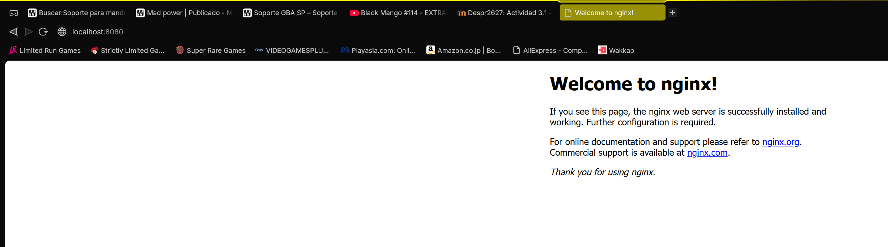

---

## 3. Dónde está cada cosa (Directorios clave)

Inspeccionamos la estructura de directorios creada durante la instalación nativa de Nginx:

```bash
$ ls -la /etc/nginx/
$ ls -la /var/www/html/
$ ls -la /var/log/nginx/
```

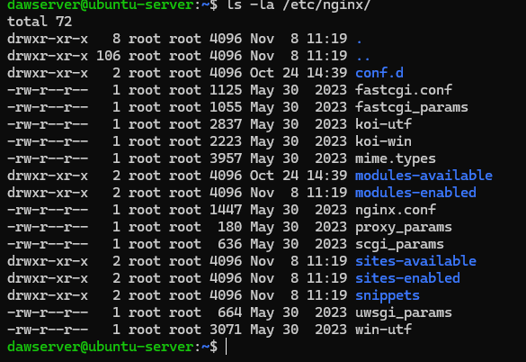

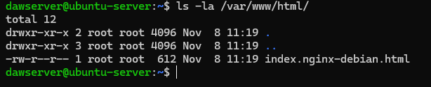

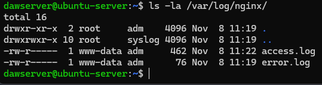

### Respuestas sobre la localización y función de cada elemento
* **Configuración principal (`/etc/nginx/nginx.conf`):** Archivo global de configuración del servidor. Define el usuario del proceso (`www-data`), número de *workers*, configuración de eventos, rutas de logs e incluye (`include`) los archivos de `conf.d/` y `sites-enabled/`.
* **Sitios disponibles (`/etc/nginx/sites-available/`):** Directorio donde se almacenan los archivos de configuración de cada sitio web o *Virtual Host*, estén activos o no en ese momento.
* **Sitios habilitados (`/etc/nginx/sites-enabled/`):** Directorio que contiene **enlaces simbólicos** apuntando a los archivos de `/etc/nginx/sites-available/` que queremos mantener activos.
* **Archivos web por defecto (`/var/www/html/`):** Directorio raíz (*DocumentRoot*) del sitio por defecto, donde se aloja el archivo `index.nginx-debian.html`.
* **Registros o Logs (`/var/log/nginx/`):**
  * `access.log`: Registra todas las peticiones HTTP recibidas por el servidor (IP cliente, fecha, método, ruta, código de estado HTTP y navegador).
  * `error.log`: Registra los fallos de arranque, errores de configuración o problemas de acceso a ficheros (permisos denegados, archivos no encontrados).
* **Unidad de systemd (`/lib/systemd/system/nginx.service`):** Archivo de definición del servicio que indica a `systemd` cómo iniciar, detener, recargar y supervisar el demonio de Nginx.

---

## 4. El cortafuegos (UFW)

### Activación de UFW permitiendo SSH
Antes de activar el cortafuegos `ufw`, permitimos explícitamente el servicio `OpenSSH` (puerto `22/tcp`) para evitar perder la conexión remota por SSH:

```bash
$ sudo ufw allow OpenSSH
Rules updated
Rules updated (v6)

$ sudo ufw enable
Command may disrupt existing ssh connections. Proceed with operation (y|n)? y
Firewall is active and enabled on system startup
```

---

### Prueba 1: Acceso HTTP con el puerto 80 cerrado
Intentamos acceder desde el navegador del anfitrión a `http://localhost:8080` forzando la recarga sin caché (`Ctrl + F5`).

> **Explicación de la Prueba 1:**  
> La política por defecto de UFW para el tráfico entrante es denegar (`deny (incoming)`). Como únicamente hemos añadido una regla para permitir el puerto `22/tcp` (`OpenSSH`), cualquier paquete entrante dirigido al puerto `80/tcp` (HTTP) de la máquina virtual es bloqueado por el cortafuegos, impidiendo la carga de la web aunque el proceso de Nginx siga activo internamente.

---

### Prueba 2: Apertura del puerto HTTP y comprobación
Listamos los perfiles de aplicación disponibles en UFW, permitimos el perfil `'Nginx HTTP'` (puerto `80/tcp`) y comprobamos las reglas numeradas:

```bash
$ sudo ufw app list
$ sudo ufw allow 'Nginx HTTP'
$ sudo ufw status numbered
Status: active

     To                         Action      From
     --                         ------      ----
[ 1] OpenSSH                    ALLOW IN    Anywhere
[ 2] Nginx HTTP                 ALLOW IN    Anywhere
[ 3] OpenSSH (v6)               ALLOW IN    Anywhere (v6)
[ 4] Nginx HTTP (v6)            ALLOW IN    Anywhere (v6)
```

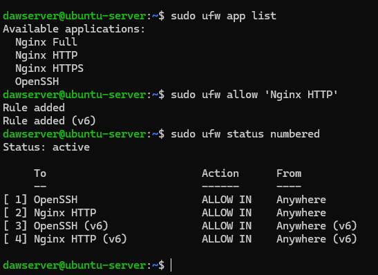

Volvemos a cargar `http://localhost:8080` en el navegador del anfitrión y comprobamos que el servicio vuelve a responder:


> **Explicación de la Prueba 2:**  
> Al añadir la regla `'Nginx HTTP'` (`ALLOW IN` sobre el puerto `80/tcp` en IPv4 e IPv6), el cortafuegos autoriza la entrada de las peticiones HTTP reenviadas desde VirtualBox hacia el proceso de Nginx, sirviendo la página inmediatamente.

---

## 5. Subir el sitio al servidor

### Creación del sitio en el anfitrión y transferencia por SCP
Al trabajar desde **Windows PowerShell** en la máquina anfitriona, creamos la estructura del sitio estático (`index.html` y `css/estilos.css`) y la transferimos mediante `scp` al directorio personal del usuario en la máquina virtual a través del puerto `2222`:

```powershell
mkdir -Force "$HOME\mi_sitio_web\css"

@"
<!DOCTYPE html>
<html lang="es">
<head>
    <meta charset="UTF-8">
    <title>Despliegue Nativo con Nginx</title>
    <link rel="stylesheet" href="css/estilos.css">
</head>
<body>
    <div class="card">
        <h1>Sitio Estático en Nginx Nativo</h1>
        <p>Práctica 1 - Despliegue de Aplicaciones Web</p>
    </div>
</body>
</html>
"@ | Set-Content -Path "$HOME\mi_sitio_web\index.html" -Encoding UTF8

@"
body { font-family: sans-serif; background-color: #f0f4f8; display: flex; justify-content: center; align-items: center; height: 100vh; margin: 0; }
.card { background: white; padding: 2rem 3rem; border-radius: 10px; box-shadow: 0 4px 12px rgba(0,0,0,0.1); text-align: center; }
h1 { color: #009639; }
"@ | Set-Content -Path "$HOME\mi_sitio_web\css\estilos.css" -Encoding UTF8

scp -P 2222 -r "$HOME\mi_sitio_web" dawserver@127.0.0.1:/home/dawserver/
```

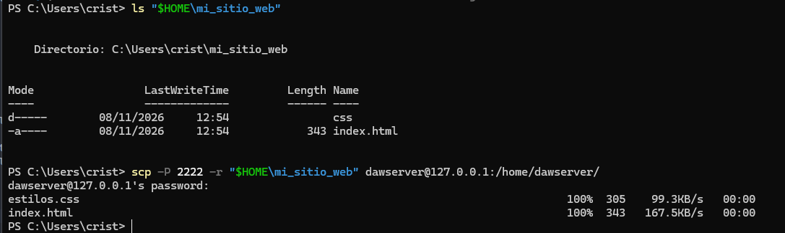

### Ubicación en `/var/www`, propietario y permisos
Dentro de la máquina virtual, movemos el directorio a `/var/www/mi_sitio_web`, asignamos como propietario y grupo a `www-data:www-data` y aplicamos permisos `755` a los directorios y `644` a los ficheros:

```bash
$ sudo mv ~/mi_sitio_web /var/www/mi_sitio_web
$ sudo chown -R www-data:www-data /var/www/mi_sitio_web
$ sudo find /var/www/mi_sitio_web -type d -exec chmod 755 {} \;
$ sudo find /var/www/mi_sitio_web -type f -exec chmod 644 {} \;
$ ls -laR /var/www/mi_sitio_web
/var/www/mi_sitio_web:
total 16
drwxr-xr-x 3 www-data www-data 4096 Nov  8 11:56 .
drwxr-xr-x 4 root     root     4096 Nov  8 12:02 ..
drwxr-xr-x 2 www-data www-data 4096 Nov  8 11:56 css
-rw-r--r-- 1 www-data www-data  343 Nov  8 11:56 index.html

/var/www/mi_sitio_web/css:
total 12
drwxr-xr-x 2 www-data www-data 4096 Nov  8 11:56 .
drwxr-xr-x 3 www-data www-data 4096 Nov  8 11:56 ..
-rw-r--r-- 1 www-data www-data  305 Nov  8 11:56 estilos.css
```

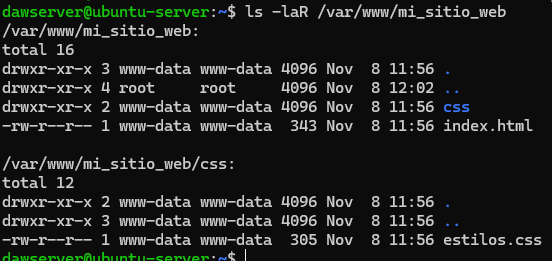

---

## 6. Crear y activar el sitio

### Creación del archivo de configuración (`Virtual Host`)
Creamos el fichero `/etc/nginx/sites-available/mi_sitio_web.conf` con la definición del bloque `server`:

```bash
sudo tee /etc/nginx/sites-available/mi_sitio_web.conf > /dev/null << 'EOF'
server {
    listen 80;
    listen [::]:80;

    root /var/www/mi_sitio_web;
    index index.html index.htm;

    server_name _;

    location / {
        try_files $uri $uri/ =404;
    }
}
EOF
```

Verificamos el contenido del fichero creado:

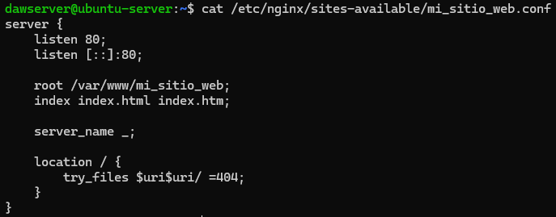

### Activación mediante enlace simbólico y validación
Creamos el enlace simbólico en `/etc/nginx/sites-enabled/`, desactivamos el sitio `default` eliminando su enlace, comprobamos la sintaxis con `sudo nginx -t` y recargamos el servicio:

```bash
$ sudo ln -s /etc/nginx/sites-available/mi_sitio_web.conf /etc/nginx/sites-enabled/
$ sudo rm /etc/nginx/sites-enabled/default
$ ls -la /etc/nginx/sites-enabled/
$ sudo nginx -t
nginx: the configuration file /etc/nginx/nginx.conf syntax is ok
nginx: configuration file /etc/nginx/nginx.conf test is successful
$ sudo systemctl reload nginx
```

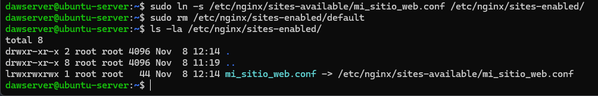

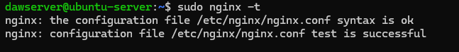

### Sitio navegable desde el anfitrión
Accedemos a `http://localhost:8080` en el navegador del anfitrión y comprobamos que se muestra nuestro sitio estático con su hoja de estilos CSS:

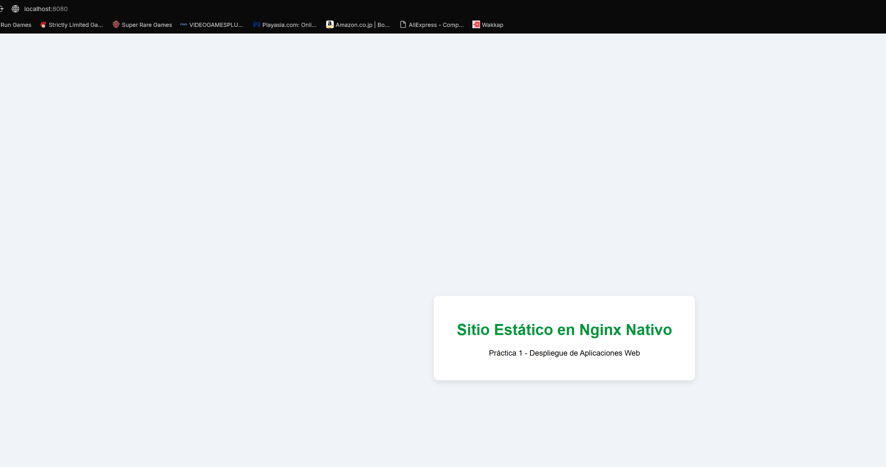

---

## 7. Provocar errores y diagnosticarlos

### Error 1: Falta de permisos de lectura (`403 Forbidden`)

1. **Cómo se provoca:** Retiramos todos los permisos al fichero `index.html` (`chmod 000`):
   ```bash
   $ sudo chmod 000 /var/www/mi_sitio_web/index.html
   $ ls -la /var/www/mi_sitio_web/index.html
   ---------- 1 www-data www-data 343 Nov  8 11:56 /var/www/mi_sitio_web/index.html
   ```
   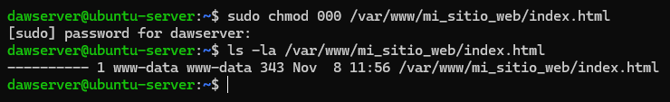

2. **Efecto en el navegador:** Al recargar `http://localhost:8080`, Nginx responde con un error **403 Forbidden**:
   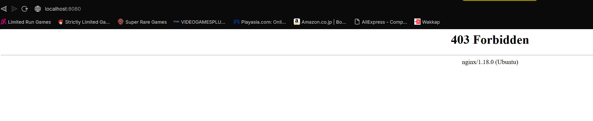

3. **Diagnóstico en los logs (`/var/log/nginx/error.log`):**
   ```bash
   $ sudo tail -n 3 /var/log/nginx/error.log
   ```
   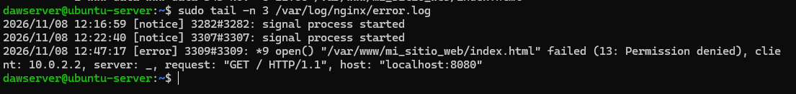
   > **Causa explicada a partir del log:** El registro `/var/log/nginx/error.log` muestra `open() "/var/www/mi_sitio_web/index.html" failed (13: Permission denied)`. El proceso trabajador (*worker*) de Nginx, ejecutado por el usuario `www-data`, carece de permisos de lectura (`r`) sobre el archivo solicitado y por tanto devuelve el estado HTTP `403`.

4. **Resolución:** Devolvemos los permisos `644` al archivo antes de continuar:
   ```bash
   $ sudo chmod 644 /var/www/mi_sitio_web/index.html
   ```
   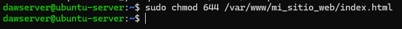

---

### Error 2: Recurso o archivo índice inexistente (`404 Not Found`)

1. **Cómo se provoca:** Renombramos temporalmente el archivo `index.html` a `index_oculto.html`:
   ```bash
   $ sudo mv /var/www/mi_sitio_web/index.html /var/www/mi_sitio_web/index_oculto.html
   ```
   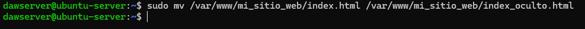

2. **Efecto en el navegador:** Al recargar `http://localhost:8080`, el servidor devuelve **404 Not Found**:
   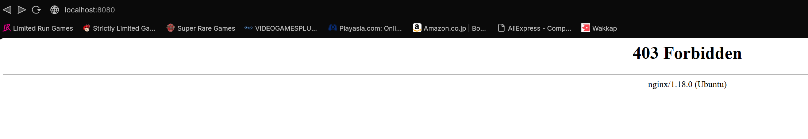

3. **Diagnóstico en los logs (`/var/log/nginx/access.log` y `error.log`):**
   ```bash
   $ sudo tail -n 3 /var/log/nginx/access.log
   $ sudo tail -n 3 /var/log/nginx/error.log
   ```
   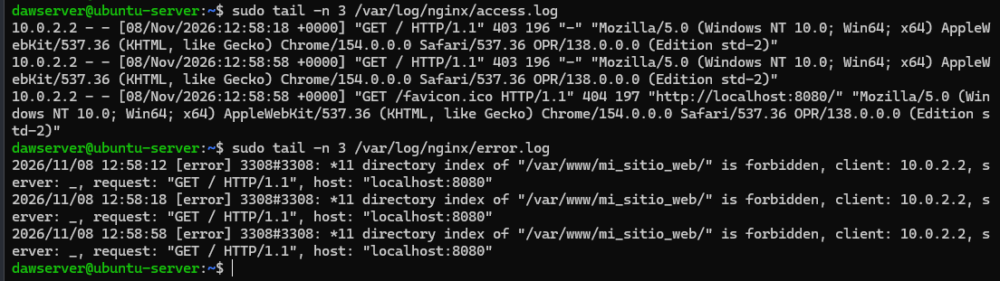
   > **Causa explicada a partir del log:** Al no encontrarse el fichero `index.html` ni `index.htm` dentro del directorio raíz `/var/www/mi_sitio_web`, la directiva `try_files $uri $uri/ =404;` devuelve directamente el código de estado `404`, quedando registrada la petición fallida en `access.log`.

4. **Resolución:** Restauramos el nombre original del archivo:
   ```bash
   $ sudo mv /var/www/mi_sitio_web/index_oculto.html /var/www/mi_sitio_web/index.html
   ```

---

### Error 3: Error de sintaxis en la configuración de Nginx

1. **Primer intento (sin `;` en `index`):** Al eliminar inicialmente el `;` de la línea `index`, observamos que `nginx -t` no fallaba porque unía la directiva `index` con la línea siguiente (`server_name _;`):
   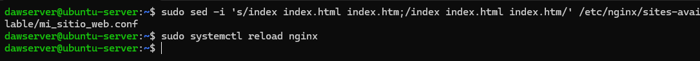

2. **Provocación del fallo sintáctico real:** Eliminamos el punto y coma (`;`) de la directiva `try_files` situada justo antes de la llave de cierre `}`:
   ```bash
   sudo tee /etc/nginx/sites-available/mi_sitio_web.conf > /dev/null << 'EOF'
   server {
       listen 80;
       listen [::]:80;

       root /var/www/mi_sitio_web;
       index index.html index.htm;

       server_name _;

       location / {
           try_files $uri $uri/ =404
       }
   }
   EOF

   sudo systemctl reload nginx
   sudo nginx -t
   sudo journalctl -u nginx.service -n 10 --no-pager
   ```

3. **Diagnóstico mediante `nginx -t` y `journalctl`:**
   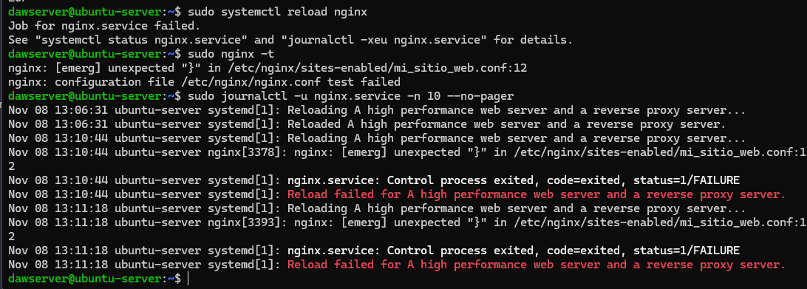
   > **Causa explicada a partir del log:** Tanto `sudo nginx -t` como `journalctl -u nginx.service` muestran el mensaje crítico `[emerg] unexpected "}" in /etc/nginx/sites-available/mi_sitio_web.conf:13`. El analizador sintáctico de Nginx esperaba un `;` para cerrar la directiva `try_files` antes de encontrar el carácter `}`. Además, al usar `systemctl reload nginx`, el proceso maestro detecta el fallo y **aborta la recarga manteniendo el servidor en funcionamiento con la configuración anterior**.

4. **Resolución:** Restauramos el `;` en `try_files $uri $uri/ =404;`, comprobamos con `sudo nginx -t` y recargamos con `sudo systemctl reload nginx`.

---

## 8. Reinicio de la máquina

Reiniciamos la máquina virtual para comprobar la persistencia del servicio y del cortafuegos:

```bash
$ sudo reboot
```

Una vez reiniciada la máquina, volvemos a entrar por SSH y verificamos el estado de Nginx y UFW:

```bash
$ systemctl is-enabled nginx
enabled
$ systemctl status nginx --no-pager
$ sudo ufw status
```

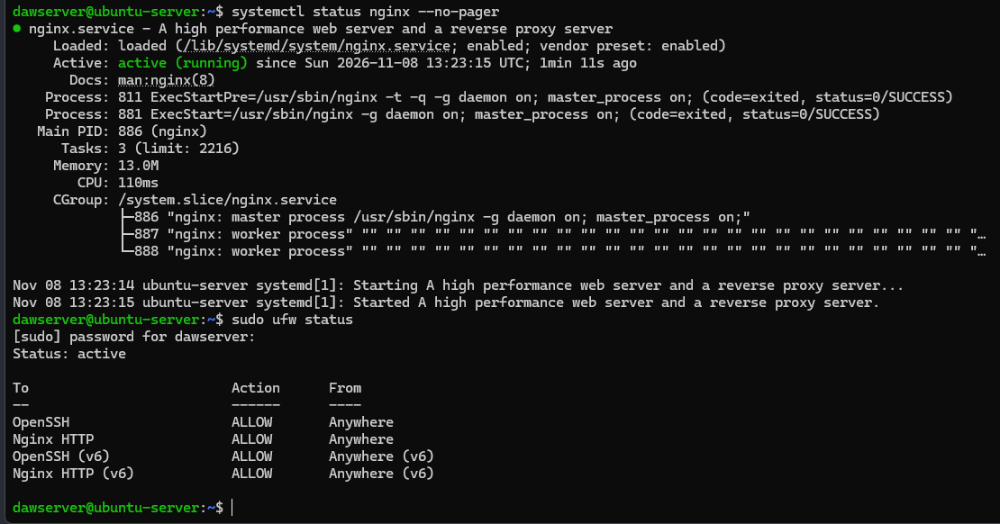

### Respuesta razonada
Tras reiniciar la máquina virtual, el sitio web **sigue estando disponible automáticamente** desde el navegador del anfitrión sin necesidad de arrancarlo de forma manual. Esto se debe a dos factores:
1. **Servicio habilitado en `systemd`:** Al instalar `nginx` en Ubuntu Server, su unidad `nginx.service` queda configurada como `enabled` (mediante un enlace simbólico en `/etc/systemd/system/multi-user.target.wants/nginx.service`). Durante la secuencia de arranque del sistema operativo, `systemd` inicia el demonio de Nginx automáticamente.
2. **Persistencia de `ufw`:** El cortafuegos UFW también se inicia con el sistema y conserva las reglas guardadas en `/etc/ufw/user.rules`, manteniendo abierto el puerto `80/tcp`.

---

## 9. Comparar con los contenedores

### Tabla comparativa: Instalación Nativa vs. Contenedores (Docker)

| Criterio | Instalación Nativa (en MV / Servidor) | Despliegue con Contenedores (Docker) |
| :--- | :--- | :--- |
| **Instalación y despliegue** | Manual mediante gestor de paquetes (`apt install nginx`). Depende de la distribución y versión del SO. | Declarativa e instantánea a partir de una imagen oficial (`docker run` o `docker compose up`). |
| **Aislamiento** | Bajo. Nginx comparte librerías, red, usuarios (`www-data`) y sistema de ficheros con el resto del SO. | Alto. El proceso corre aislado en su propio *namespace* de procesos, red y sistema de archivos. |
| **Ubicación de ficheros** | Repartidos por el sistema (`/etc/nginx`, `/var/www`, `/var/log/nginx`, `/lib/systemd/system`). | Encapsulados en el contenedor; se mapean desde una única carpeta del proyecto mediante volúmenes (*bind mounts*). |
| **Gestión del servicio** | Mediante el sistema de inicio del SO (`systemctl start/reload/status nginx`). | Mediante el motor de Docker (`docker compose restart`, `docker ps`). |
| **Consulta de registros (Logs)** | Archivos en disco (`/var/log/nginx/access.log` y `error.log`) y `journalctl`. | Flujo de salida estándar (`stdout`/`stderr`) consultable de forma centralizada con `docker logs`. |
| **Portabilidad y replicación** | Baja. Migrar a otro servidor requiere repetir la instalación, usuarios, permisos y reglas de firewall paso a paso. | Muy alta. Un único archivo `compose.yml` permite levantar exactamente el mismo entorno en cualquier máquina en segundos. |
| **Consumo de recursos** | Si requiere una MV exclusiva, consume mucha RAM y disco por el SO invitado completo. | Muy ligero; comparte el kernel del anfitrión y solo ejecuta el proceso de Nginx. |

### Conclusiones razonadas
1. **¿Cuándo conviene una instalación nativa?** Cuando el servidor (o máquina virtual) está dedicado exclusivamente a actuar como servidor web o *reverse proxy* principal de infraestructura, o cuando se quiere administrar con herramientas tradicionales de sistemas (`systemd`, `ufw`, `logrotate`) sin añadir la capa de virtualización de contenedores.
2. **¿Cuándo conviene usar contenedores?** Cuando buscamos portabilidad total entre el entorno de desarrollo y producción, necesitamos desplegar múltiples aplicaciones o distintas versiones de Nginx en el mismo servidor sin conflictos de puertos ni librerías, o queremos versionar toda la infraestructura como código en un repositorio Git.

---

## 10. Incidencias encontradas y resolución

Durante el desarrollo de la práctica han surgido tres incidencias técnicas que se han diagnosticado y resuelto de la siguiente forma:

### Incidencia 1: Error `ParserError` al usar sintaxis `<< 'EOF'` en la terminal del anfitrión
* **Síntoma:** Al intentar crear el archivo `index.html` en la máquina anfitriona ejecutando `cat << 'EOF' > ~/mi_sitio_web/index.html`, la consola devolvió el error `El operador '<' está reservado para uso futuro`.
* **Causa:** La terminal empleada en el ordenador anfitrión era **Windows PowerShell**, la cual no soporta redirecciones *Heredoc* (`<<`) propias de intérpretes Bash en Linux.
* **Solución:** Se adaptó el comando utilizando bloques *Here-String* nativos de PowerShell (`@" ... "@ | Set-Content -Path ... -Encoding UTF8`), generando los archivos correctamente antes de transferirlos con `scp`.

### Incidencia 2: Error `404 Not Found` tras activar el nuevo sitio en Nginx
* **Síntoma:** Después de crear `/etc/nginx/sites-available/mi_sitio_web.conf`, enlazarlo en `sites-enabled` y recargar Nginx, al acceder a `http://localhost:8080` el navegador mostraba `404 Not Found` aunque el archivo `/var/www/mi_sitio_web/index.html` existía y tenía los permisos correctos.
* **Causa:** Al revisar el fichero de configuración con `cat`, se observó que la directiva `try_files` estaba escrita como `try_files $uri$uri/ =404;` (sin espacio entre `$uri` y `$uri/`). Esto provocaba que Nginx concatenase ambas variables formando una ruta inexistente y saltase directamente al error `=404`.
* **Solución:** Se separaron las variables con un espacio (`try_files $uri $uri/ =404;`) y se recargó la configuración con `sudo systemctl reload nginx`, quedando el sitio operativo inmediatamente.

### Incidencia 3: Omitir el `;` en la directiva `index` no provocaba fallo en `nginx -t`
* **Síntoma:** En la Parte 7, al borrar el punto y coma (`;`) al final de `index index.html index.htm;`, el comando `sudo nginx -t` seguía informando `syntax is ok`.
* **Causa:** Dado que la directiva `index` acepta múltiples nombres de archivo separados por espacios o saltos de línea, Nginx unió esa línea con la siguiente (`server_name _;`) e interpretó `server_name` y `_` como nombres de ficheros índice adicionales hasta encontrar el `;` de cierre.
* **Solución:** Para forzar y diagnosticar un error sintáctico real, se eliminó el `;` en la última directiva del bloque `location` (`try_files $uri $uri/ =404`), justo antes de la llave de cierre `}`, obteniendo el error esperado `[emerg] unexpected "}"` en `nginx -t` y `journalctl`.